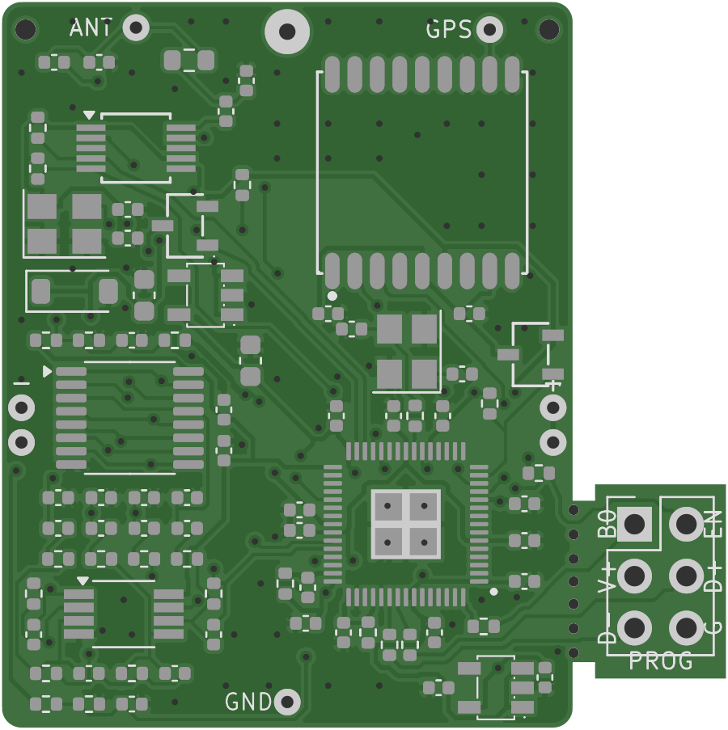

# R20 - HF balloon tracker with a receiver (FT8 contacts + WSPR)

The idea: a pico balloon that makes ordinary FT8 contacts (answers callers like a normal station), stores them in a log,
sends the log down in FT8 data frames, accepts signed commands from the ground and also beacons WSPR for tracking.

**Status (2026-11-23): boards v0.2 are ordered, nothing has been built or powered up yet. The receiver, the transmitter level
and the whole concept are unproven on hardware.**

## Hardware v0.2 (`pcb_v0.2/`)
- `R20_v0_2_gerber.zip`, `BOM_R20_v0_2.csv`, `CPL_R20_v0_2.csv` - the files sent to JLCPCB (Economic PCBA, top side, 0.8 mm).
- MCU RP2354A (QFN-60), 12 MHz crystal, USB for flashing (BOOTSEL), no SWD pads.
- Core supply from an external 1.1 V LDO (U8, TLV74311P) instead of the on-chip switcher: no inductor, less switching noise next to the receiver.
  VREG_FB to ground, VREG_LX open, VREG_AVDD/VREG_VIN powered (RP2350 datasheet, external core supply).
- TX: Si5351A + 26 MHz TCXO, CLK0 through 100 nF to the ANT pad; pads for an optional low-pass filter (C24, C25 not fitted).
- RX: ANT -> SN74CBTLV3253 used as a 4-phase mixer driven by Si5351 CLK1/CLK2 -> TLV9062 differential amplifiers -> ADC (I and Q).
- GPS ATGM336H and the Si5351/TCXO are behind P-MOSFET power switches. 3.3 V from ME6211C33.
- Solar input with pads for a supercapacitor (SC+ / SC-) on the bottom; D1 (clamp) not fitted.
- Break-off PROG tab with a 2x3 pin header: B0, EN, V+, D+, D-, G.
- GPIO: GPS UART 8 (TX) / 9 (RX), I2C 16 / 17, receiver supply from GPIO19, ADC0-2 for I, Q and panel voltage.
- Not fitted by design: C24, C25, D1.

### Known issues of v0.2
- The first BOM had a 1.2 V regulator for the core (ME6211C12). RP2350 recommends 1.05-1.16 V (absolute max 1.21 V).
  The BOM here already has the 1.1 V part (C485147, same SOT-23-5 pinout).
- Only 1 uF at DVDD (datasheet suggests 4.7 uF at the far pin).
- KiCad sources of v0.2 are not in this repository yet - only the production files.
- JLCPCB adds two 1.15 mm tooling holes for assembly (one under the GPS module, one in the ground pour). They do not cut any track.

## Firmware: GOLkf (`firmware_golkf/`)
`rdzen/golkf.c`, `rdzen/golkf.h` - the logic core, hardware independent (about 8 kB of code on Cortex-M33):
energy levels from panel voltage and sun elevation, window plan (TX/RX), FT8 contact state machine, log, signed commands,
WSPR schedule (Traquito channel maths), no-transmit zones.
**There is no hardware layer yet (Si5351, I/Q receiver + decoder, GPS, flash, USB), so this cannot be flashed.**
`test/buduj.sh` builds the core as a PC library together with kgoba/ft8_lib (MIT).
The command key (16 bytes) is not in the code; it is meant to be written at programming time.

## `sim_m33/` - can an RP2350 decode FT8 in time?
kgoba/ft8_lib built for Cortex-M33 and run in QEMU (mps2-an505) on recorded audio, counting instructions.
Busy 20 m recording: 19 decodes with default settings; with 70 candidates / 20 LDPC iterations 18 decodes and
about 85 million instructions after the window, estimated 0.7-1.0 s on a 150 MHz RP2350 (an estimate, not a measurement).

## `power_budget/`
`bilans.py` - rough current budget for six 52 x 23 mm cells in series and a mass estimate. Component currents are typical
values, not measurements.

## Callsigns
The callsigns in the code are placeholders (`QQ0QQQ` for WSPR, `QQ0Q` for FT8). Set your own before transmitting; an amateur licence is required.

## Related
The 433 MHz LoRa camera tracker from the same author: https://github.com/Anakreont/T433-lora-photo-tracker-

## Licence
MIT (see `LICENSE`) for the code and the board files. Design by SQ9GOL. Source comments are in Polish.
